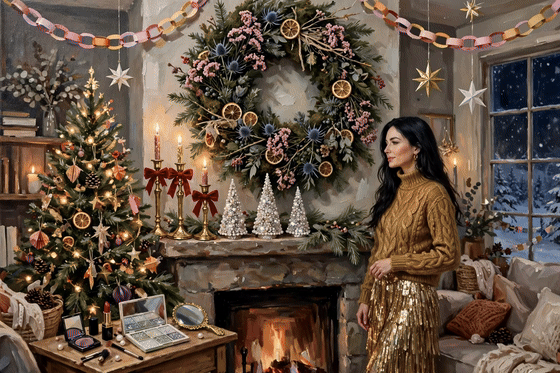

# Instagram Daily Trends

Every day, we find what's trending on Instagram in fashion, home decor, and beauty — and paint it as a painterly animation.

## Today's Animation · 2026-11-19



> In the animation: her long wavy hair sways softly, the fireplace flames flicker, the Christmas tree lights twinkle, snow falls slowly outside the windows, and the glitter on her lips, eyeshadow, and hair sparkles. The grain and brushstroke texture of the illustration is preserved all the way through — never smoothed out, never recolored. HD video version: [assets/latest.mp4](assets/latest.mp4). Still illustration: [assets/2026-11-19.png](assets/2026-11-19.png).

## Today's Trends

### 👗 Fashion — Velvet, sequins, and feather trims — holiday party looks from Zara, H&M, and Anthropologie

A 6.7K-like reel runs six festive looks — a leopard-print blouse with brown fur trim, black velvet shorts, and black knee-high boots; a burgundy velvet pantsuit with black satin lapels; a black sleeveless turtleneck with a red sequin mini skirt and knee-high boots; a black long-sleeve sequin romper; a burgundy floral lace mini dress; and a black ruffled V-neck mini dress. A 6.1K-like try-on models a long brown satin maxi dress with a matching feather-trimmed capelet and a silver glitter clutch, a burgundy sequined mini dress with a square neckline and fluffy white heels, and a black velvet sweetheart-neck top tucked into a white pleated mini skirt. A 5.1K-like Anthropologie reel presents three holiday party outfits — a silver sequin maxi skirt with a white bralette and sheer shirt, pearl and crystal earrings, and a red plaid coat with a burgundy faux-fur collar; a cobalt blue satin gown with a light-blue faux-fur stole; and a black long-sleeve ruched turtleneck midi dress. A 4.8K-like Zara haul cycles through seven outfits — a burgundy velvet suit with a feather-cuff blazer; a white double-breasted blazer mini-dress; a black strapless bow top with sparkly flared trousers; a black embellished halter top with sheer lace flared pants; a brown tweed jacket with feather cuffs and satin burgundy trousers; a black velvet wrap suit with floral embroidery; and a silver sequined fringe mini dress. A 4.5K-like Walmart carousel, posted today, runs 17+ affordable festive looks — a red puff-sleeve top with a black sequin mini skirt and pearl-buckle heels, a red knit midi dress, sparkly wide-leg jeans, a white puff-sleeve corset top with a silver sequin skirt, and burgundy and black sequin halter mini dresses under $20. A 4.2K-like try-on runs seven looks including an all-white halter top with a satin maxi skirt, a black sequined velvet jumpsuit, and a grey knit two-piece set. A 3.8K-like H&M Partywear reel models three black evening outfits — a floor-length dress with side waist cutouts, a blazer-style mini dress with sheer tights and gold-tip heels, and a black lace high-neck top with a black velvet mini skirt.

### 🛋️ Home Decor — The lights switch on — baby-face garlands, wand-lit trees, and DIY bauble garlands

A 92K-like DIY tutorial makes a "Christmas baby face garland" — baby faces cut from printed photographs, Santa hats folded from festive paper with ricrac trim and pom-poms, threaded onto a dark green velvet ribbon and draped through the Christmas tree. A 73K-like reel, posted today, opens on a glamorous tree reveal — a woman in a red ruffled dress walks toward a large tree with gold ribbons, ornaments, and a star topper, flanked by illuminated wire reindeer and a life-size Santa statue, while two small dogs wander in. A 50K-like reel shows a child raising a wand toward a tall tree dressed entirely in red ornaments, berries, and silver tinsel — the white string lights suddenly switch on, wrapping the tree in bright light. A 37K-like reel preps a front entrance for Christmas — black lanterns with red velvet bows, small potted evergreens, a lighted branch tree in a woven basket, wire-frame reindeer, large gold jingle bells, and two green wreaths hung on the glass double doors. A 12K-like reel sends in a "Santa Helpers" team — a flocked artificial tree with white and silver ornaments, polar bear figures, and a snowman base, plus garlands for the TV console and dining table. An 11K-like tutorial builds DIY balloon Christmas lights from inflated balloons topped with gold-painted paper cups and tinsel loops. Another 11K-like tutorial folds green paper circles into 3D paper trees with red bows and yellow stars, strung on twine as a garland. A 10K-like high-rise decorating reel assembles a tall Balsam Hill tree with warm white lights and long red velvet ribbons, then continues in nutcracker-print pajamas. A 10K-like reel makes a bauble garland by drilling holes through ornaments, threading them on white string, and draping the strands in swags around the tree.

### 💄 Beauty — Glitter lips, burgundy eyes, and Thanksgiving glam — holiday beauty goes maximal

A 16K-like reel presents a Thanksgiving dinner glam — short curly platinum-blonde hair, pink-purple eyeshadow, heavy contour and highlight, and glossy lips with a black turtleneck. A 15K-like close-up demos two glitter-infused lip balms — "Fizzy Bubbles," a sparkly mauve-pink, and "Crystal Caviar," a brown-berry glitter — swatched on the hand and worn over MAC lip liners. A 9.3K-like Maybelline ad runs a full routine — Grippy Serum primer, Super Stay Lumi-Matte Foundation, brown lip liner, a red matte lipstick, and a setting spray mist. A 5.3K-like full-glam tutorial works on a blonde model in pink satin pajamas — Artist Couture palettes, glitter pigment pressed on with fingers, LYS Beauty false lashes, Hourglass foundation, and a Scooby-Doo lip gloss. A 4.9K-like "Christmas hair hack" dusts Fenty glitter through a section of hair for a sparkling effect. A 4.7K-like tutorial builds a "Burgundy Christmas" eye — pink-burgundy shimmer on the lid and lower lash line, a reverse cut crease, and chunky glitter patted onto the center. A 3.5K-like reel, posted today, teaches a holiday glam eyeshadow — dramatic pink and burgundy smoky eyes with a bright shimmery center from the Blend Bunny palette, a neon yellow waterline, and a glossy brown lip. A 3.2K-like reel, also posted today, builds a Disney-inspired colorful eye — bright blue winged liner, purple-pink shimmer on the lid, and vibrant blue mascara on top and bottom lashes.

## How It Works, Every Day

1. **Discover trends**: find what's currently popular on Instagram in fashion, home decor, and beauty through public trend discovery, ranked by engagement.
2. **Illustration**: paint one illustration that weaves the day's trends into a single scene — painterly style (grain, loose brushstrokes, muted palette).
3. **Animation**: turn the illustration into a 10-second animation (hair, flames, light all moving) and embed it at the top of the README as an autoplaying GIF, with the HD video linked alongside.
4. **Archive**: the day's trends are saved as `data/YYYY-MM-DD.json`; the illustration and animation as `assets/YYYY-MM-DD.png` / `.mp4` / `.gif`.

## Data Notes (Please Read First)

- **Data source**: public Instagram trend discovery. No Instagram account is connected. This project is not affiliated with Instagram / Meta.
- **What this is**: a sketch of what is popular in these three domains right now — not a platform-wide census, and not a ranking of all trends.
- **Illustration and animation**: both AI-generated. The illustration style reference is a private image and is not included in this repo.

## Repo Structure

```
instagram-daily-trends/
├── README.md                  # Today's animation + today's trends (updated daily)
├── assets/
│   ├── latest.gif             # Latest day's animation (autoplaying)
│   ├── latest.mp4             # Latest day's animation (HD video)
│   ├── YYYY-MM-DD.gif         # Each day's animation
│   ├── YYYY-MM-DD.mp4         # Each day's animation (HD video)
│   └── YYYY-MM-DD.png         # Each day's illustration
├── data/
│   └── YYYY-MM-DD.json        # Each day's trends (fashion / home decor / beauty)
└── scripts/
    └── run_daily.py           # Daily pipeline checklist + output verification
```

## Archive

- [2026-11-19](data/2026-11-19.json) — Fashion / Home Decor / Beauty · Animation: [GIF](assets/2026-11-19.gif) · [Video](assets/2026-11-19.mp4)
- [2026-11-18](data/2026-11-18.json) — Fashion / Home Decor / Beauty · Animation: [GIF](assets/2026-11-18.gif) · [Video](assets/2026-11-18.mp4)
- [2026-11-17](data/2026-11-17.json) — Fashion / Home Decor / Beauty · Animation: [GIF](assets/2026-11-17.gif) · [Video](assets/2026-11-17.mp4)
- [2026-11-16](data/2026-11-16.json) — Fashion / Home Decor / Beauty · Animation: [GIF](assets/2026-11-16.gif) · [Video](assets/2026-11-16.mp4)
- [2026-11-15](data/2026-11-15.json) — Fashion / Home Decor / Beauty · Animation: [GIF](assets/2026-11-15.gif) · [Video](assets/2026-11-15.mp4)
- [2026-11-14](data/2026-11-14.json) — Fashion / Home Decor / Beauty · Animation: [GIF](assets/2026-11-14.gif) · [Video](assets/2026-11-14.mp4)
- [2026-11-13](data/2026-11-13.json) — Fashion / Home Decor / Beauty · Animation: [GIF](assets/2026-11-13.gif) · [Video](assets/2026-11-13.mp4)
- [2026-11-11](data/2026-11-11.json) — Fashion / Home Decor / Beauty · Animation: [GIF](assets/2026-11-11.gif) · [Video](assets/2026-11-11.mp4)
- [2026-11-10](data/2026-11-10.json) — Fashion / Home Decor / Beauty · Animation: [GIF](assets/2026-11-10.gif) · [Video](assets/2026-11-10.mp4)
- [2026-11-09](data/2026-11-09.json) — Fashion / Home Decor / Beauty · Animation: [GIF](assets/2026-11-09.gif) · [Video](assets/2026-11-09.mp4)
- [2026-11-08](data/2026-11-08.json) — Fashion / Home Decor / Beauty · Animation: [GIF](assets/2026-11-08.gif) · [Video](assets/2026-11-08.mp4)
- [2026-11-07](data/2026-11-07.json) — Fashion / Home Decor / Beauty · Animation: [GIF](assets/2026-11-07.gif) · [Video](assets/2026-11-07.mp4)
- [2026-11-06](data/2026-11-06.json) — Fashion / Home Decor / Beauty · Animation: [GIF](assets/2026-11-06.gif) · [Video](assets/2026-11-06.mp4)
- [2026-11-05](data/2026-11-05.json) — Fashion / Home Decor / Beauty · Animation: [GIF](assets/2026-11-05.gif) · [Video](assets/2026-11-05.mp4)
- [2026-11-04](data/2026-11-04.json) — Fashion / Home Decor / Beauty · Animation: [GIF](assets/2026-11-04.gif) · [Video](assets/2026-11-04.mp4)
- [2026-11-03](data/2026-11-03.json) — Fashion / Home Decor / Beauty · Animation: [GIF](assets/2026-11-03.gif) · [Video](assets/2026-11-03.mp4)
- [2026-11-02](data/2026-11-02.json) — Fashion / Home Decor / Beauty · Animation: [GIF](assets/2026-11-02.gif) · [Video](assets/2026-11-02.mp4)
- [2026-11-01](data/2026-11-01.json) — Fashion / Home Decor / Beauty · Animation: [GIF](assets/2026-11-01.gif) · [Video](assets/2026-11-01.mp4)
- [2026-10-31](data/2026-10-31.json) — Fashion / Home Decor / Beauty · Animation: [GIF](assets/2026-10-31.gif) · [Video](assets/2026-10-31.mp4)
- [2026-10-30](data/2026-10-30.json) — Fashion / Home Decor / Beauty · Animation: [GIF](assets/2026-10-30.gif) · [Video](assets/2026-10-30.mp4)
- [2026-10-29](data/2026-10-29.json) — Fashion / Home Decor / Beauty · Animation: [GIF](assets/2026-10-29.gif) · [Video](assets/2026-10-29.mp4)
