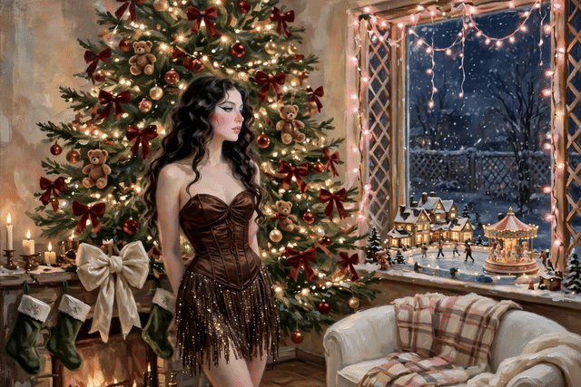

# Instagram Daily Trends

Every day, we find what's trending on Instagram in fashion, home decor, and beauty — and paint it as a painterly animation.

## Today's Animation · 2026-11-01



> In the animation: her hair sways softly, fireplace and candle flames flicker, chandelier light shimmers, and steam drifts up from her coffee cup. The grain and brushstroke texture of the illustration is preserved all the way through — never smoothed out, never recolored. HD video version: [assets/latest.mp4](assets/latest.mp4). Still illustration: [assets/2026-11-01.png](assets/2026-11-01.png).

## Today's Trends

### 👗 Fashion — Layered fall outfits, back to everyday staples after Halloween

The day after Halloween, fashion returns to everyday layered fall staples: trench coats in camel, olive and black over oversized knit sweaters and turtlenecks, wide-leg trousers and straight-leg jeans, loafers, ballet flats and ankle boots in beige, brown and black. Suede jackets, mini skirts with sheer tights and knee-high boots, and an Abercrombie fall lookbook keep the same warm-neutral palette going into November.

### 🛋️ Home Decor — Cozy fall living rooms, candlelit and layered

Cozy fall living rooms stay candlelit and layered: light-colored sectional sofas with brown and cream pillows and chunky knit throws, lit fireplaces, chandeliers, candles on mantels and coffee tables, and dried hydrangeas and eucalyptus in vases. Small white pumpkins linger as the last fall accents, and evening tours show the same rooms glowing with warm lamp and candlelight.

### 💄 Beauty — Soft fall glam, warm and glowy

Soft fall glam holds as the everyday beauty look: warm-toned eyeshadow, softly defined eyes with winged liner and mascara, cream blush and contour for a warm, sculpted cheek, and glossy nude-pink lips over a dewy, light base. Tutorials frame it as the go-to routine for fall — polished but wearable, with highlighter and setting spray to keep the glow.

## How It Works, Every Day

1. **Discover trends**: find what's currently popular on Instagram in fashion, home decor, and beauty through public trend discovery, ranked by engagement.
2. **Illustration**: paint one illustration that weaves the day's trends into a single scene — painterly style (grain, loose brushstrokes, muted palette).
3. **Animation**: turn the illustration into a 10-second animation (hair, flames, light all moving) and embed it at the top of the README as an autoplaying GIF, with the HD video linked alongside.
4. **Archive**: the day's trends are saved as `data/YYYY-MM-DD.json`; the illustration and animation as `assets/YYYY-MM-DD.png` / `.mp4` / `.gif`.

## Data Notes (Please Read First)

- **Data source**: public Instagram trend discovery. No Instagram account is connected. This project is not affiliated with Instagram / Meta.
- **What this is**: a sketch of what is popular in these three domains right now — not a platform-wide census, and not a ranking of all trends.
- **Illustration and animation**: both AI-generated. The illustration style reference is a private image and is not included in this repo.

## Repo Structure

```
instagram-daily-trends/
├── README.md                  # Today's animation + today's trends (updated daily)
├── assets/
│   ├── latest.gif             # Latest day's animation (autoplaying)
│   ├── latest.mp4             # Latest day's animation (HD video)
│   ├── YYYY-MM-DD.gif         # Each day's animation
│   ├── YYYY-MM-DD.mp4         # Each day's animation (HD video)
│   └── YYYY-MM-DD.png         # Each day's illustration
├── data/
│   └── YYYY-MM-DD.json        # Each day's trends (fashion / home decor / beauty)
└── scripts/
    └── run_daily.py           # Daily pipeline checklist + output verification
```

## Archive

- [2026-11-01](data/2026-11-01.json) — Fashion / Home Decor / Beauty · Animation: [GIF](assets/2026-11-01.gif) · [Video](assets/2026-11-01.mp4)
- [2026-10-31](data/2026-10-31.json) — Fashion / Home Decor / Beauty · Animation: [GIF](assets/2026-10-31.gif) · [Video](assets/2026-10-31.mp4)
- [2026-10-30](data/2026-10-30.json) — Fashion / Home Decor / Beauty · Animation: [GIF](assets/2026-10-30.gif) · [Video](assets/2026-10-30.mp4)
- [2026-10-29](data/2026-10-29.json) — Fashion / Home Decor / Beauty · Animation: [GIF](assets/2026-10-29.gif) · [Video](assets/2026-10-29.mp4)
